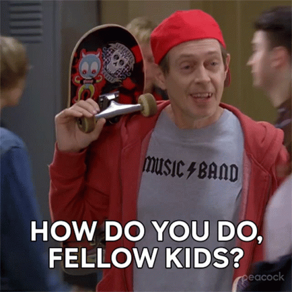

<!-- HEADER BANNER -->
<div align="center">  
    
  

  <br />

  <table>
    <tr>
      <td align="center" bgcolor="#1f2937">
        <h2>🚀 À LA RECHERCHE D'UNE ALTERNANCE</h2>
        <p><strong>Contrat de professionnalisation — BTS SIO option SISR (2026-2028)</strong><br />
        🏫 <strong>École :</strong> MyDigitalSchool Angers — 📍 <strong>Secteur :</strong> Angers / Avrillé et agglomération</p>
      </td>
    </tr>
  </table>
</div>

<br />

---

## 🎯 Projet Professionnel

Ancien **communiquant** reconverti dans le **développement web**, je poursuis aujourd'hui mon évolution vers les **infrastructures, systèmes et réseaux** à travers la préparation d'un **BTS SIO (option SISR)** en contrat de professionnalisation chez **MyDigitalSchool Angers**.

Ma philosophie : **allier rigueur technique, logique de résolution de problèmes et pédagogie utilisateur**. Fort de mes expériences passées, j'apporte une vision globale du SI, combinant la gestion de parc, le support de proximité, l'administration serveur et une forte aisance relationnelle.

---

## 💼 Expériences Professionnelles

```text
2024 — 2026  │ Développeur Web (Auto-entrepreneur)
             │ • Analyse des briefs clients et réalisation d'applications web (PHP, React).
             │ • Création et gestion de bases de données MySQL.

2013 — 2026  │ Évaluateur Internet — Telus International
             │ • Évaluation de la pertinence des résultats de recherche et analyse d'autorité/crédibilité.
             │ • Rédaction de rapports et application stricte de directives qualité.

2012 — 2013  │ Chargé des Relations Publiques — Conseil régional des Pays de la Loire
             │ • Organisation d'événements grand public et gestion des relations presse.
             │ • Conception de plans média, supports de communication et visites pédagogiques.
```
---

## 🎓 Cursus & Formations

```text
2026 — 2028  │ BTS SIO (Services Informatiques aux Organisations)
             │ Option SISR (Solutions d'Infrastructures, Systèmes et Réseaux)
             │ MyDigitalSchool, Angers

2023         │ Titre Professionnel Développeur Web et Web Mobile (Bac +2)
             │ Studi

2010 — 2011  │ Maîtrise Communication Produit & Dispositif 360°
             │ SciencesCom, Audencia Group, Nantes

2007 — 2010  │ Bachelor Marketing & Communication
             │ École Atlantique de Commerce, Nantes
```
